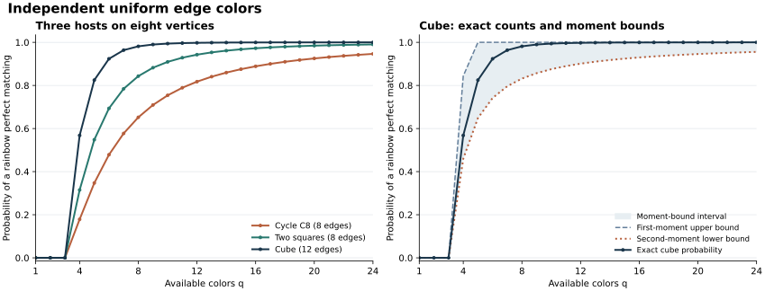

# Discrete Math Lab

[](https://github.com/Akhil-rav/discrete-math-lab/actions/workflows/checks.yml)

Proofs and reproducible experiments in extremal combinatorics, graph theory,
and algorithms. The main thread studies rainbow perfect matchings, from
small-case searches to structural proofs and exact probabilities.

## Selected work

| Study | Main outcome | Read |
|---|---|---|
| **Extremal cube colorings** | A proof of the seven-color maximum; all 174 extremizers classified into nine symmetry classes | [Report](results/cube_classification.md) · [Four-page paper](papers/cube_classification.pdf) · [Labeled atlas](results/figures/cube_classes.svg) |
| **Independent random edge colors** | Exact rainbow-matching probabilities on six hosts, moment bounds, and a large-palette limit linked to the 174 extremizers | [Report and plot](projects/random-colorings/report.md) · [Counting proofs](notes/random_rainbow.md) · [Exact data](results/data/random_rainbow.json) |
| **Expansion and random walks** | Elementary cut formulas and exact examples separating periodicity from disconnection | [Three-page paper](papers/expansion_walks.pdf) · [Project report](projects/expansion-and-walks/report.md) |

The cube study combines an [incidence proof](notes/cube_upper_bound.md), an
exhaustive [symmetry classification](results/cube_classification.md), and a
[capacity-and-overlap analysis](results/cube_collisions.md). Color names and
graph symmetries are distinguished throughout.



The plot compares three eight-vertex hosts and the cube's analytic moment
bounds. The underlying probabilities are exact rationals; the curves are a
presentation of the saved data.

## Foundations and supporting studies

| Topic | Artifact |
|---|---|
| Even cycles and two disjoint squares | [Elementary extremizer proofs](papers/cycle_extremizers.pdf) |
| Sparse bipartite hosts | [Six exact searches through twelve edges](projects/rainbow-matchings/report.md) |
| Complete bipartite symmetry | [Four classes among 87 extremal K3,3 partitions](results/k33_classification.md) |
| Matching theory | [Hall's theorem](notes/halls_theorem.md) and [4,477 regular-graph checks](results/regular_bipartite_small_cases.md) |
| Additive combinatorics | [Rainbow arithmetic progressions](results/rainbow_progressions.md) |
| Graph algorithms | [Vertex color-coding](notes/color_coding.md) and [finite algorithm checks](results/algorithm_demos.md) |

[Project guide](projects/README.md) · [Literature and source scope](notes/literature/README.md)
· [Implementation guide](src/README.md) · [References](references.bib)
· [All results](results/README.md)

The writeups distinguish elementary proofs, reproductions of published results,
and exhaustive finite computations. No originality or publication is claimed.
Review limitations and the exact tested ranges appear in the individual reports.

## Reproduce

Python **3.11+**; mathematical computations use the standard library. From the
repository root, one command runs the integrity checks, tests, and all five
reference-data reproductions. To start from a fresh clone:

```sh
git clone https://github.com/Akhil-rav/discrete-math-lab.git
cd discrete-math-lab
python -m tools.verify_repository
```

Automated checks run on Linux with Python 3.11 and 3.13, and on Windows with
Python 3.13. No package installation is required for this sequence.

Use `--static-only` for links, JSON, recorded output hashes, and reviewed source
checks without mathematical reruns. See [individual commands](experiments/README.md)
and the [verification index](results/verification_index.md) for historical records
and the limits of these checks.

Plots need optional [Matplotlib requirements](requirements-figures.txt) only to
regenerate their images. [Typeset notes](papers/README.md) include LaTeX sources
and build instructions. Reading the committed figures and PDFs needs neither.

Akhil Ravuri
