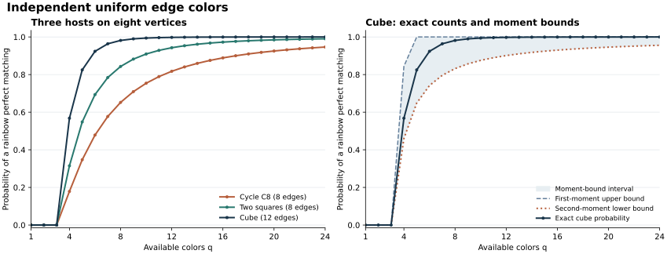

# Exact probabilities of rainbow perfect matchings

**Status:** elementary counting identities and exact finite computations.
No novelty claim.

[Typeset report](../../papers/random_rainbow.pdf) · [LaTeX source](../../papers/random_rainbow.tex)
· [Definitions and proofs](../../notes/random_rainbow.md) · [Exact data](../../results/data/random_rainbow.json)
· [Implementation](../../src/rainbow_probability.py) · [Verification](../../results/random_rainbow_verification.md)

## Question and model

Give every edge of a fixed graph an independent, uniformly chosen color from a
palette of q labeled colors. What is the probability that at least one perfect
matching is rainbow?

The palette contains q **available** colors. The coloring need not use all of
them, and it need not be proper. The host graph stays fixed; only its colors
are random. This is a different sampling model from choosing an edge partition
uniformly or conditioning on exactly q colors being used.



The left panel compares three hosts with four-edge perfect matchings. The right
panel compares the exact cube probability with first- and second-moment bounds.
Shading marks the interval between those analytic bounds, not statistical
uncertainty. Points represent integer palette sizes; joining lines guide the eye.
The underlying values are rational, with floating-point conversion only for plotting.

## From avoiding partitions to probabilities

Let m be the number of edges and let a_k count avoiding partitions into k color
classes, with edges fixed and color names ignored. Each such partition admits
exactly (q)_k assignments of distinct palette colors to its blocks. Consequently,

$$
\Pr(\text{at least one rainbow perfect matching})
=1-\frac{\sum_k a_k(q)_k}{q^m}.
$$

Here (q)_k is the falling factorial, zero when k>q. The
[existing exhaustive histograms](../../results/data/sparse_rainbow.json) supply
the a_k values. The new computation performs exact weighted counting; it does
not simulate random trials.

## Six-host comparison

All percentages below are rounded to two decimal places. The exact fractions
and all integer palettes 1 through 24 are in the dataset.

| Host | Edges | Edges per perfect matching | Perfect matchings | First q with probability at least 1/2 | Probability at q=4 | Probability at q=8 |
|---|---:|---:|---:|---:|---:|---:|
| C4 | 4 | 2 | 2 | 2 | 93.75% | 98.44% |
| C6 | 6 | 3 | 2 | 4 | 60.94% | 88.18% |
| C8 | 8 | 4 | 2 | 7 | 17.87% | 65.21% |
| Two disjoint C4s | 8 | 4 | 4 | 5 | 31.49% | 84.31% |
| K3,3 | 9 | 3 | 6 | 3 | 93.64% | 99.76% |
| Cube | 12 | 4 | 9 | 4 | 56.80% | 98.15% |

The first-crossing column is checked by evaluating every smaller positive
integer q. It is a fact about these six fixed graphs and this coloring model,
not an asymptotic threshold theorem.

For the cube at q=4, the exact probability is **4653/8192**. The comparison
also shows why the extremal maximum by itself does not determine a random
coloring's behavior: the full avoiding histogram enters the probability formula.

An eight-color palette does not force every sampled cube coloring to have a
rainbow matching: some assignments use fewer than eight colors. This is
consistent with the extremal statement A(Q3)=7, which concerns colors actually
used rather than colors merely available.

## Bounds from matching overlap

Let X count rainbow perfect matchings. A fixed n-edge matching is rainbow with
probability p=(q)_n/q^n. If the graph has N perfect matchings, then E[X]=Np.

For two distinct matchings sharing s edges and q>=n, the probability that both
are rainbow is

$$
\frac{(q)_n(q-s)_{n-s}}{q^{2n-s}}.
$$

Thus pairwise overlap determines the second moment E[X^2]. The bounds are

$$
\frac{\mathbb E[X]^2}{\mathbb E[X^2]}
\le \Pr(X>0)\le \min(1,\mathbb E[X]).
$$

When E[X^2]=0, the event is impossible and both bounds are defined as zero.
The [proof note](../../notes/random_rainbow.md) derives these bounds and the
joint probability, including the q<n boundary case. All 144 main-grid rows
are checked to lie between the bounds exactly.

For the cube at q=4, E[X]=27/32 and E[X^2]=99/64, giving the explicit comparison

$$\frac{81}{176}\le\frac{4653}{8192}\le\frac{27}{32}.$$

The expected number of rainbow matchings differs from the probability of
finding one, because one coloring can contain several rainbow matchings.

## How the 174 extremizers control the large-palette tail

If A is the maximum avoiding color count, (q)_A is a monic polynomial of degree
A. Therefore

$$
q^{m-A}\Pr(\text{no rainbow perfect matching})\longrightarrow a_A.
$$

For the cube, m=12, the [incidence proof](../../notes/cube_upper_bound.md) gives
A=7, and the [classification](../../results/cube_classification.md) gives
a_7=174. Hence the scaled avoidance probability q^5 Pr(no rainbow matching)
converges to **174**. The nine orbit sizes sum to this coefficient.

The dataset records exact scaled values at q=32,64,128,256,1024. At q=32 it is
about 361.18, and at q=1024 about 180.72. The limit alone is therefore not an
accurate small-palette approximation. Its proof uses the leading polynomial
term; those five examples illustrate the limit rather than establish it.

## Verification and reproduction

```sh
python -m experiments.random_rainbow --check results/data/random_rainbow.json
python -m unittest discover -s tests -v
```

The main computation and all tests use Python 3.11+ and the standard library.
Tests directly enumerate named color assignments on C4, C6, and two disjoint
squares. Analytic even-cycle probabilities give a separate oracle. Every
overlap size for two rainbow events on four edge positions is also
checked by direct named-color enumeration with palettes 1 through 4.

To regenerate the figure, install the optional plotting requirement:

```sh
python -m pip install -r requirements-figures.txt
python -m experiments.plot_random_rainbow
```

Matplotlib is a presentation dependency only. No plot or numerical tolerance
is used to establish the probability values or inequalities.
