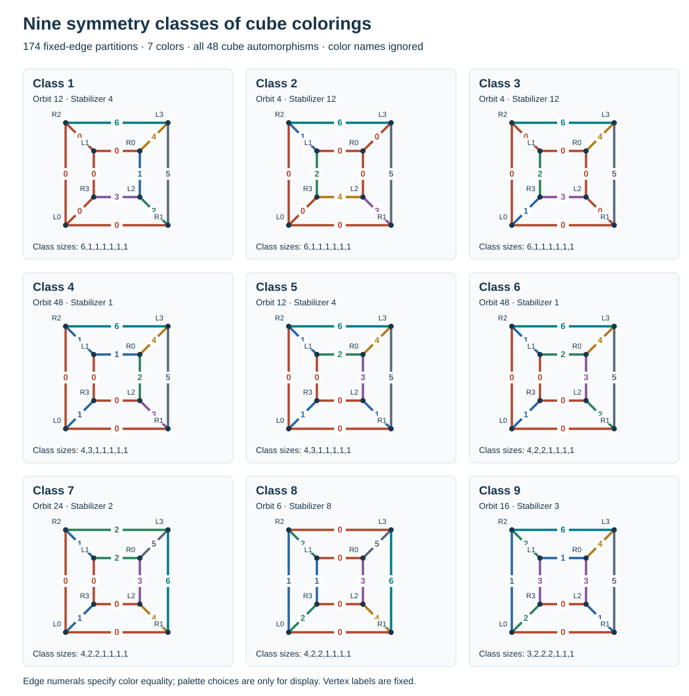

# Extremal cube colorings: nine symmetry classes

This computation classifies all 174 extremal partitions under cube symmetries
and color renaming.

[Typeset report](../papers/cube_classification.pdf) · [LaTeX](../papers/cube_classification.tex)
· [Complete dataset](data/cube_classification.json) · [Verification](cube_verification.md)

The **174** fixed-edge partitions that use seven colors and avoid every rainbow
perfect matching of the cube split into **nine classes** under all cube
automorphisms and color renaming. The orbit sizes are
**12, 4, 4, 48, 12, 48, 24, 6, 16**, summing to 174.



## Model and equivalence

The [incidence proof](../notes/cube_upper_bound.md) now establishes the maximum
of seven independently of search. Its [capacity balance](cube_collisions.md)
also explains a 150/24 split of the extremal population. The nine-orbit list
and these population counts remain finite computational classifications.

Use left vertices L0,...,L3 and right vertices R0,...,R3, with LiRj an edge
exactly when i differs from j. This is K4,4 minus its diagonal matching, hence
the cube. In binary-cube coordinates, the left vertices are 000,011,101,110;
Ri is the bitwise complement of Li. An edge changes exactly one bit.

Edges are ordered lexicographically by (i,j), skipping the diagonal. The twelve
positions therefore correspond to `01,02,03,10,12,13,20,21,23,30,31,32`.
Each representative below is a restricted-growth string in that order.
Colors are renamed by first appearance. The initial count of 174 keeps all
edge positions fixed; the final nine-class count also identifies graph symmetries.
Colorings need not be proper.

| Class | Canonical representative | Color-class sizes | Orbit | Stabilizer |
|---|---|---|---:|---:|
| 1 | `000000123456` | 6,1,1,1,1,1,1 | 12 | 4 |
| 2 | `000012034056` | 6,1,1,1,1,1,1 | 4 | 12 |
| 3 | `001002003456` | 6,1,1,1,1,1,1 | 4 | 12 |
| 4 | `001110230456` | 4,3,1,1,1,1,1 | 48 | 1 |
| 5 | `001210310456` | 4,3,1,1,1,1,1 | 12 | 4 |
| 6 | `001210320456` | 4,2,2,1,1,1,1 | 48 | 1 |
| 7 | `001210340562` | 4,2,2,1,1,1,1 | 24 | 2 |
| 8 | `012021340560` | 4,2,2,1,1,1,1 | 6 | 8 |
| 9 | `012123310456` | 3,2,2,2,1,1,1 | 16 | 3 |

The stabilizer fixes the color partition; it may permute color names.
In every row, orbit size times stabilizer size is 48. Every member of every
orbit is saved in the dataset, not just one witness per class.

## The full symmetry group

A connected bipartite graph has a unique bipartition up to exchange: the parity
of a path from one fixed vertex determines the parts. Thus a cube automorphism
either preserves both parts or swaps them. In the preserving case, left and
right permutations must agree, because each Li has Ri as its unique nonneighbor
in the other part. Every simultaneous permutation of the four indices works.
There are 4! preserving maps and another 4! obtained by exchanging the parts.

The resulting **48** distinct maps act on edge indices. After applying a map,
the transformed colors are normalized again. The canonical representative is
the lexicographically least partition in the orbit. Tests independently inspect
all 8!=40,320 vertex bijections and recover exactly these edge actions.

## Structural distinctions

The first three classes share the same block sizes, but their six-edge color
classes have the following sorted vertex degrees, including isolated vertices:

| Class | Monochromatic degree sequence | Description |
|---|---|---|
| 1 | 3,3,2,2,1,1,0,0 | Edges incident to two vertices of the same part |
| 2 | 3,3,1,1,1,1,1,1 | Two disjoint three-edge stars |
| 3 | 2,2,2,2,2,2,0,0 | A six-cycle and two isolated vertices |

These are different graph invariants, so the three partitions are inequivalent.
The other repeated block-size profiles are separated by color multiplicities
within the nine perfect matchings:

| Class | Matching color-multiplicity profiles and counts |
|---|---|
| 4 | (2,1,1): nine |
| 5 | (2,1,1): eight; (3,1): one |
| 6 | (2,1,1): nine |
| 7 | (2,1,1): eight; (2,2): one |
| 8 | (2,1,1): eight; (4): one |

In particular, class 8 has a monochromatic perfect matching. Class 9 has a
unique block-size profile. Together, block sizes, the largest color class's
degree sequence, and matching profiles distinguish all nine recorded classes;
this assertion is checked in the test suite. This is not a claim that these
invariants classify arbitrary colored graphs.

## Search coverage and independent checks

The new pass enumerates all **S(12,7)=627,396** partitions into exactly seven
blocks. It prunes only impossible block counts, not rainbow prefixes. Coverage
is checked against the independent Stirling recurrence. Every candidate is
tested against all nine perfect matchings. Exactly 174 survive.

The [earlier sparse-host search](../projects/rainbow-matchings/report.md) covers
all B12=4,213,597 partitions using exact rejected-subtree counts. It separately
establishes the maximum of seven and the same population count of 174. The
seven-color pass alone would not exclude colorings using eight or more colors.

Verification also checks:

- All four-edge subsets independently reconstruct the nine matchings.
- A direct equal-color-pair test validates every saved member.
- All 8! vertex maps independently reconstruct the automorphism group.
- The 48 edge actions are closed under composition.
- Orbits are disjoint, remain inside the avoiding population, and cover it.
- Stabilizers are counted explicitly, rather than inferred only by division.
- The target-block iterator agrees with unfiltered partitions for every n<=7
  and every feasible block count.

These are independent algorithms within the same review process, not external
refereeing. Full provenance is in the [verification record](cube_verification.md).

## Reproduce

From the repository root, with Python 3.11+ and the standard library:

```sh
python -m experiments.classify_cube --check results/data/cube_classification.json
python -m unittest discover -s tests -v
python -m experiments.render_cube_atlas
```

The final command regenerates the SVG atlas and LaTeX source from the dataset;
it does not perform the classification. Rebuild the PDF with
`tectonic --outdir papers papers/cube_classification.tex`.

## Literature and interpretation

The [scoped literature check](../notes/literature/cube_classification.md) records
adjacent cubic-bipartite work and its access limits. A theorem about the maximum
over a graph family is different from this fixed-host orbit classification.
No result here is labeled original, and no development task is certified open.
